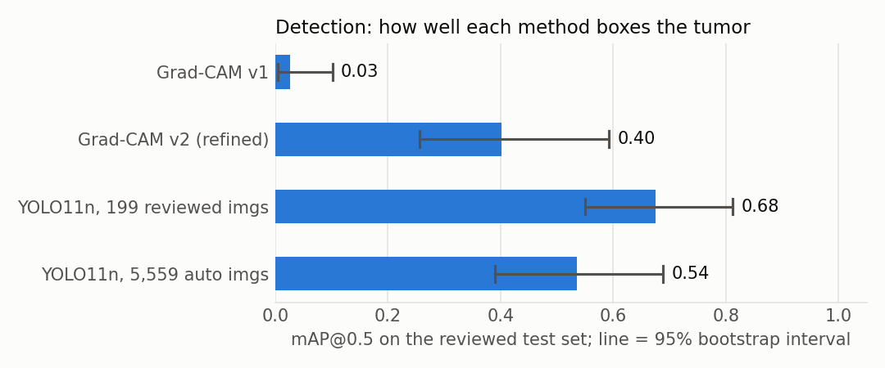
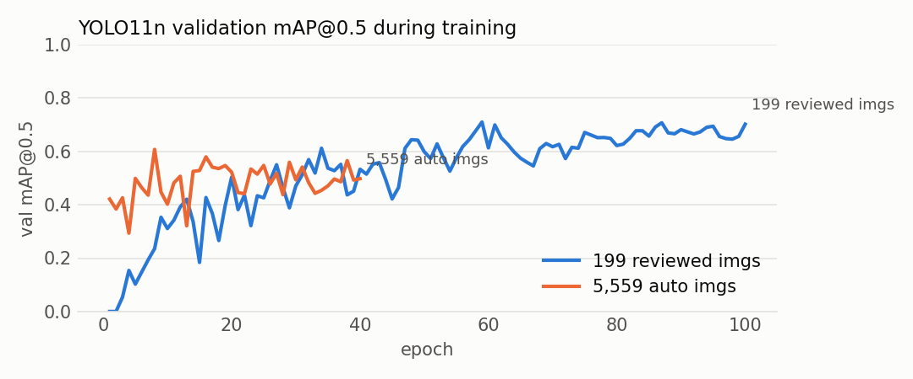
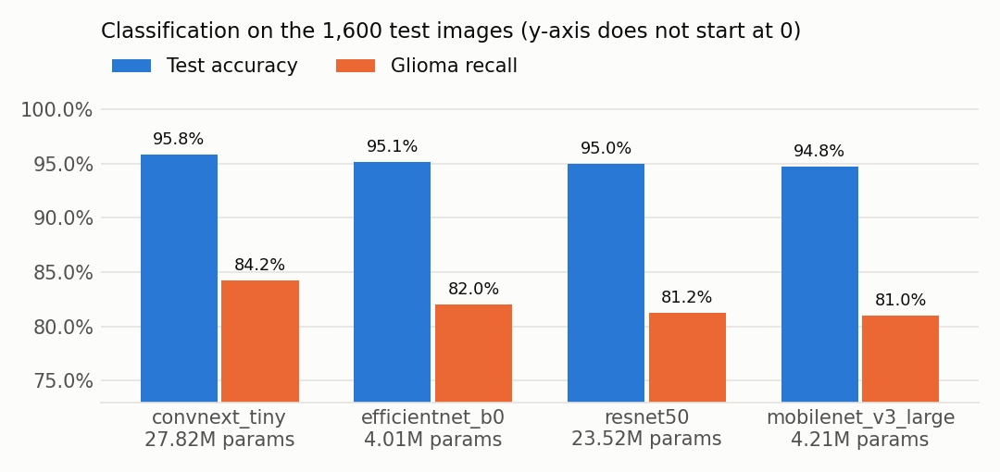

# Benchmark

All numbers come from one run on an RTX 3050 Ti laptop GPU (4 GB). Scripts and settings are listed in the [README](README.md).

## Key findings

- **A detector trained on 199 clean boxes beats one trained on 5,559 noisy boxes** at finding the tumor: mAP@0.5 is 0.68 vs 0.54.
  The intervals overlap, so this is a strong hint rather than proof.
- **The noisy-label detector draws tighter boxes**, with a higher mAP@0.5:0.95 of 0.32 vs 0.25. Part of this is a test-set bias, explained below.
- **Raw Grad-CAM is not a detector.** Version 1 boxes are almost never right (mAP@0.5 0.03). The brightness refinement lifts it to 0.40,
  still well below either trained detector.
- **The trained detectors are about 3× faster** than the Grad-CAM pipeline: 11–15 ms vs 29–38 ms per image.
- **Meningioma is the easiest tumor to box and pituitary the hardest**, for every method.
- **For classification, the backbone barely matters.** All four land between 94.8% and 95.8% test accuracy, and all miss 16–19% of gliomas.
  The glioma problem comes from the data, not the architecture.
- **MobileNetV3 and EfficientNet-B0 are the efficient choices.** They are about 6× smaller than ResNet50 and lose at most one point of accuracy.

## Detection

Test set: 68 Testing images, made of 48 tumor images with a human-reviewed box and 20 no-tumor images. Every method has to predict the
class itself. The Grad-CAM methods use the classifier's predicted class and draw no box when it predicts no tumor.



| Method | mAP@0.5 | 95% interval | mAP@0.5:0.95 | Box right place, any class (AP@0.5) | Tumor images boxed correctly | False alarms on no-tumor | ms / image |
|---|---|---|---|---|---|---|---|
| Grad-CAM v1 | 0.027 | 0.00 to 0.10 | 0.010 | 0.012 | 10% | 0% | 29 |
| Grad-CAM v2 (refined) | 0.402 | 0.26 to 0.59 | 0.330 | 0.371 | 54% | 0% | 38 |
| YOLO11n, 199 reviewed imgs | **0.676** | 0.55 to 0.81 | 0.245 | **0.677** | **69%** | 0% | **11** |
| YOLO11n, 5,559 auto imgs | 0.536 | 0.39 to 0.69 | 0.316 | 0.540 | 60% | 0% | 15 |

| Method | Glioma AP@0.5 | Meningioma AP@0.5 | Pituitary AP@0.5 |
|---|---|---|---|
| Grad-CAM v1 | 0.042 | 0.039 | 0.000 |
| Grad-CAM v2 (refined) | 0.413 | 0.565 | 0.226 |
| YOLO11n, 199 reviewed imgs | **0.582** | **0.896** | **0.549** |
| YOLO11n, 5,559 auto imgs | 0.547 | 0.597 | 0.465 |

**How to read the columns.**
- **mAP@0.5:** a box counts as correct when it overlaps the reviewed box by at least 50% (IoU ≥ 0.5) and has the right class. The score
  is averaged over the three tumor classes.
- **mAP@0.5:0.95:** the same, averaged over stricter overlap thresholds up to 95%. It rewards tight boxes.
- **Tumor images boxed correctly** and **false alarms** use a confidence threshold of 0.25.
- **95% interval:** from 1,000 bootstrap resamples of the test images.

### Training curves



The detector on 5,559 automatic boxes plateaus around 0.5 by epoch 15, so more epochs would not help it.
The detector on 199 reviewed boxes keeps improving until about epoch 60. Both curves are measured on the benchmark test set,
so they are shown only to illustrate training. The scores above use the final-epoch weights, so the test set played no part in choosing them.

### Caveats

- **The test set is small.** With 48 boxes, intervals span about ±0.13 mAP. A difference smaller than that between two methods may be noise.
- **The test set favors Grad-CAM v2 and the noisy-label detector.** 24 of the 48 reviewed test boxes are Grad-CAM v2 boxes that the reviewer
  accepted unchanged. A method that reproduces v2's exact box shape gets extra credit at strict overlap thresholds. This is why Grad-CAM v2 has the
  highest mAP@0.5:0.95, and it likely explains part of the noisy-label detector's lead on that metric too. At the 50% threshold the bias matters much less.
- **The 0% false alarms come from only 20 no-tumor images.** A real false-alarm rate needs a larger negative set.
- **The reviewer is not a radiologist.** Reviewed boxes are careful non-expert estimates.

## Classification

Same settings for every backbone: ImageNet-pretrained, 224×224 input, 8 epochs, AdamW with a one-cycle schedule,
evaluated once on the 1,600 Testing images. Speed is measured with mixed precision on the RTX 3050 Ti.



| Backbone | Params | Test acc | Macro F1 | Glioma | Meningioma | No tumor | Pituitary | Train time | Latency bs1 | Throughput bs32 |
|---|---|---|---|---|---|---|---|---|---|---|
| ConvNeXt-Tiny | 27.8M | **95.8%** | **0.957** | **84.2%** | 99.2% | 100.0% | 99.8% | 6 min | 5.8 ms | 402 img/s |
| EfficientNet-B0 | 4.0M | 95.1% | 0.950 | 82.0% | 98.5% | 100.0% | 100.0% | 3 min | 6.5 ms | 1,015 img/s |
| ResNet50 | 23.5M | 95.0% | 0.949 | 81.2% | 99.0% | 100.0% | 99.8% | 5 min | 5.0 ms | 498 img/s |
| MobileNetV3-Large | 4.2M | 94.8% | 0.946 | 81.0% | 98.5% | 99.8% | 99.8% | 2 min | 5.0 ms | **1,774 img/s** |

The per-class columns are recall: the share of that class's test images that were classified correctly.

**These accuracy differences are mostly noise.** ResNet50 scored 95.6% in the first run and 95.0% here, with identical settings except
the data-loading worker count, which changes the random augmentation order. Gaps under about one point should not decide a model choice.
The glioma recall pattern, by contrast, is consistent across all four backbones.

**The classification test split may contain duplicates of training images.** The main project's `src/dedup.py` builds a leak-free split.
These numbers use the original Kaggle split, so treat them as an upper bound.

## Reproduce

```bash
bash outputs/run_bench.sh
python src/make_benchmark_charts.py
```

Raw results: `outputs/bench_detection.json`, `outputs/cls_*/metrics.json`, `outputs/yolo/*/results.csv`.
