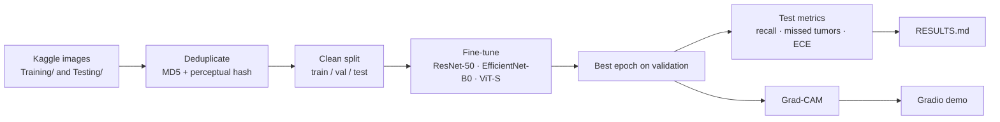

# Brain Tumor MRI Classification


Classifies brain MRI slices into **glioma, meningioma, pituitary tumor or no tumor**, with a focus on what
matters in medical imaging: a test set free of duplicate images, the number of **missed tumors**, calibrated
confidence, and **Grad-CAM** heatmaps that show where the model looked.

Three transfer-learning backbones are compared on the same clean split: **ResNet-50**, **EfficientNet-B0**
and a small **Vision Transformer (ViT-S/16)**.

> Research and education only. This is not a medical device and must not be used for diagnosis.

## Results

Run the pipeline (below), then paste the table from `results/RESULTS.md` here.

| Model | Params (M) | Accuracy | Macro F1 | Tumor recall | Missed tumors | ECE |
|---|---:|---:|---:|---:|---:|---:|
| ResNet-50 | | | | | | |
| EfficientNet-B0 | | | | | | |
| ViT-S/16 | | | | | | |

*Tumor recall* = share of tumor scans not classified as "no tumor". *ECE* = expected calibration error
(lower means the model's confidence matches its accuracy).

<!-- After training, add: results/<model>/confusion_matrix.png, reliability.png and gradcam_examples.png -->

## Why duplicate removal matters

Public brain MRI datasets often contain the same scan more than once: exact copies, re-encoded copies, or
images placed in both the training and testing folders. If a scan appears in both train and test, the model
is graded on images it has already seen, and accuracy looks better than it is.

`src/dedup.py` hashes every image (MD5 for exact copies, perceptual hash for re-encoded ones), merges
duplicates into groups, drops groups whose copies carry different labels, then builds a stratified
70 / 15 / 15 train / validation / test split by group. Nothing can leak across splits. The numbers it finds
are written to `results/dedup_report.json`.

## Pipeline



- **Training:** AdamW, cosine learning-rate schedule, light augmentation (crop, flip, small rotation,
  brightness/contrast), mixed precision on GPU, early stopping on validation macro F1.
- **Model selection** uses the validation split only. The test split is touched once, at the end.

## Quickstart

### On Google Colab (recommended, free GPU)
Open `notebooks/train_colab.ipynb` in Colab, select a GPU runtime and run all cells. It downloads the data,
removes duplicates, trains the three models, and produces the table and figures.

### Locally
```bash
pip install -r requirements-dev.txt

# 1. Dataset: https://www.kaggle.com/datasets/masoudnickparvar/brain-tumor-mri-dataset
#    Extract it so that you have data/raw/Training/<class>/ and data/raw/Testing/<class>/
kaggle datasets download -d masoudnickparvar/brain-tumor-mri-dataset -p data/raw --unzip

# 2. Remove duplicates and build the split
python -m src.dedup

# 3. Train and evaluate (one model, or all three)
python -m src.train --model resnet50 --epochs 15
python -m src.train --model all

# 4. Comparison table and Grad-CAM examples
python -m src.compare
python -m src.gradcam --checkpoint checkpoints/resnet50.pt
```

## Demo

```bash
cp checkpoints/<best_model>.pt checkpoints/best.pt
python app/app.py
```

Upload a scan to get the class probabilities and the Grad-CAM heatmap.

To publish it on **Hugging Face Spaces** (free): create a Gradio Space, then upload `app/app.py` as
`app.py`, `app/requirements.txt` as `requirements.txt`, the `src/` folder, and your checkpoint as
`checkpoints/best.pt`.

## Project structure

```
src/
├── config.py      # classes, backbones, paths
├── dedup.py       # duplicate detection and leak-free split
├── data.py        # dataset and transforms
├── models.py      # timm backbones and Grad-CAM target layers
├── train.py       # training, early stopping, test evaluation
├── metrics.py     # tumor recall, missed tumors, calibration, plots
├── gradcam.py     # heatmaps for one image or a grid of test images
└── compare.py     # results table across models
app/app.py         # Gradio demo
notebooks/         # Colab training notebook
tests/             # pytest suite on synthetic images (runs in CI, no dataset needed)
```

## Tests

```bash
python -m pytest -q
```

The tests build a small synthetic dataset with planted duplicates (an exact train/test leak, a re-encoded
copy, a scan with two labels) and check that the deduplication catches all of them. They also run the full
pipeline end to end: train, evaluate, compare and Grad-CAM.

## Limitations

- Trained on 2D slices from a single public dataset; performance on scans from other hospitals or machines
  is unknown.
- Labels come from the dataset and are not clinically verified.
- Grad-CAM shows where the model looked, not why it is right; a plausible heatmap does not prove a
  correct diagnosis.

See [MODEL_CARD.md](MODEL_CARD.md) for intended use and evaluation details.

## Dataset

[Brain Tumor MRI Dataset](https://www.kaggle.com/datasets/masoudnickparvar/brain-tumor-mri-dataset)
by Masoud Nickparvar on Kaggle. Check its license on the dataset page before redistributing images.
The images are not stored in this repository.

## License

Code under the MIT License.
